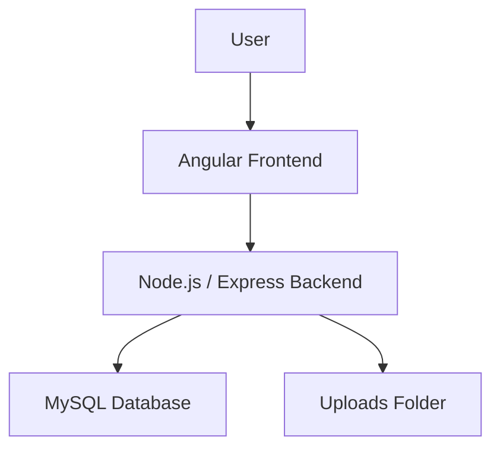
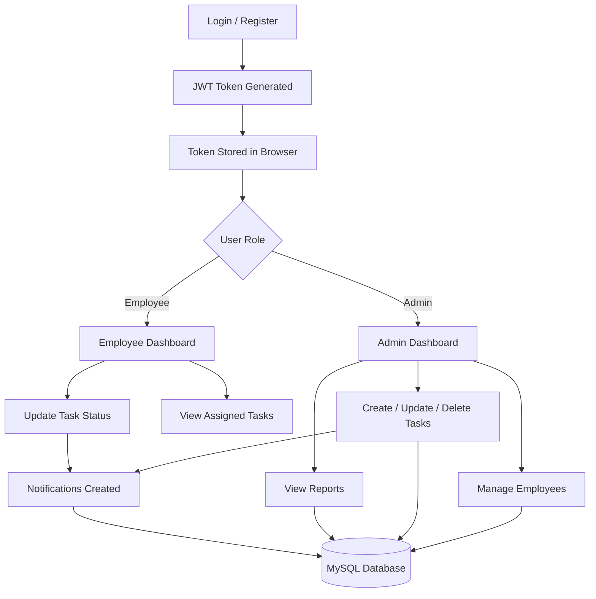
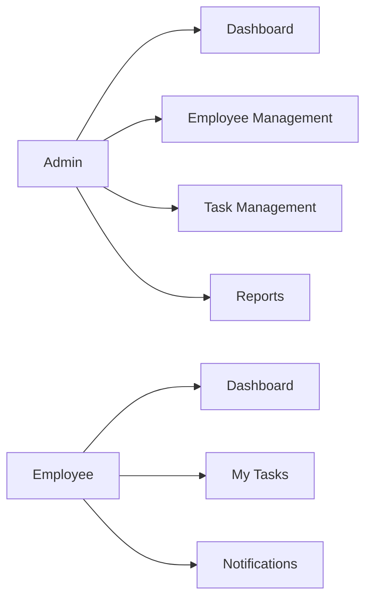
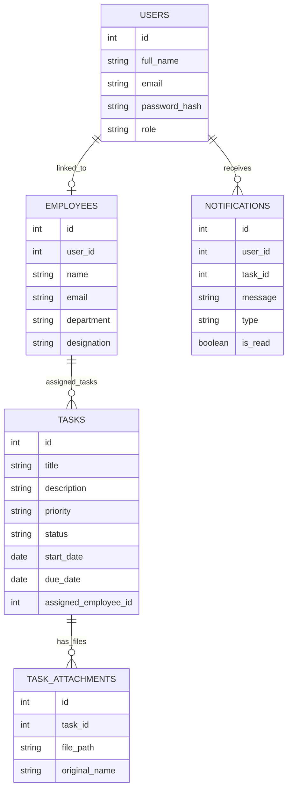

# Architecture / Flow Diagram

## Basic Flow

## Application Flow

## Role Flow

## Database Tables

## Short Explanation

The Angular frontend sends requests to the Express backend using REST APIs.  
The backend checks JWT authentication and user role before allowing access.  
Admin users can manage employees, tasks, and reports.  
Employee users can view their own dashboard and assigned tasks only.  
All data is stored in MySQL. Uploaded files are stored in the backend uploads folder, and their file paths are saved in the database.